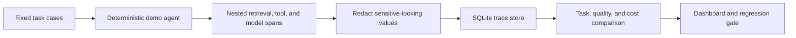

  

<h1 align="center">TraceForge</h1>

A local observability and regression-testing project for AI agents. It captures nested spans around retrieval, tools, and model calls; redacts sensitive-looking fields before persistence; evaluates prompt versions on the same fixed dataset; and shows comparisons in a dashboard and CI-style command.

Synthetic demo only: the bundled agent is deterministic and makes no external model calls. Its scores illustrate workflow, not real-world model quality.

## How it works

TraceForge records a deterministic agent run as nested spans, then compares prompt versions against the same fixed evaluation cases.

The bundled agent makes no external model calls. A demo run records a baseline and an intentionally regressed candidate; the gate compares them with configured thresholds and can fail a CI command when quality drops too far. Demo costs and scores are illustrative only.

## Run locally

Requires Python 3.11 or newer; runtime uses the standard library.

    py -3 -m venv .venv
    .\.venv\Scripts\Activate.ps1
    cd site
    npm ci
    npm run build
    cd ..
    .\scripts\run.ps1 demo
    .\scripts\run.ps1 serve

Open http://127.0.0.1:8000. The server has no authentication; keep it on loopback.

## Commands

- .\scripts\run.ps1 demo records baseline and intentionally regressed prompt runs.
- .\scripts\run.ps1 gate exits 1 when candidate quality exceeds configured thresholds.
- .\scripts\run.ps1 gate --max-task-drop 0.25 allows a task-success drop of up to 25 percentage points.
- .\scripts\run.ps1 serve --port 8000 starts the dashboard.
- On macOS/Linux set PYTHONPATH=src and run python -m traceforge.cli demo or serve.

Demo reruns replace only traces tagged traceforge_sample_v1. Other traces are preserved. Generated SQLite and JSON reports are under data/generated/ and ignored by Git.

## API

GET /api/health, GET /api/summary, GET /api/traces?limit=100&offset=0,
GET /api/traces/{trace_id}, and POST /api/demo/rerun.

## Limits

The evaluator is deterministic, not an LLM judge. Sample costs are illustrative, not provider pricing. Redaction is best effort. The local server has no authentication. No production integration or load benchmark is claimed. See docs/ for architecture, schema, evaluators, CI, privacy, and walkthrough.

