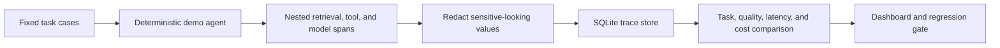

<p align="center">
  
</p>

<h1 align="center">TraceForge</h1>

<p align="center">
  <strong>Know which prompt change broke your agent.</strong><br />
  Local tracing, redaction, evaluation, and a CI gate for AI agents — standard library only.
</p>

<p align="center">
  <a href="https://github.com/nihalmachhi/TraceForge/actions/workflows/ci.yml"></a>
  <a href="https://github.com/nihalmachhi/TraceForge/actions/workflows/pages.yml"></a>
  <a href="https://pypi.org/project/traceforge/"></a>
  
  
  <a href="LICENSE"></a>
  
</p>

<p align="center">
  <a href="#quick-start">Quick start</a> ·
  <a href="#how-it-works">How it works</a> ·
  <a href="#commands">Commands</a> ·
  <a href="#api">API</a> ·
  <a href="https://nihalmachhi.github.io/TraceForge/">Live demo</a> ·
  <a href="docs/">Docs</a>
</p>

---

TraceForge records a deterministic agent run as nested spans, redacts sensitive-looking values
before persistence, scores two prompt versions on the same fixed dataset, and fails a CI step when
quality drops past configured limits.

> **Synthetic demo only.** The bundled agent is deterministic and makes no external model calls.
> Scores, costs, and latencies illustrate the workflow, not real-world model quality or provider
> pricing.

## What you get

| | Capability | Why it matters |
| :---: | --- | --- |
| 🧵 | **Nested spans** | Retrieval, tool, and model calls become parent-linked spans with timing, tokens, and estimated cost. |
| 🛡️ | **Redaction before storage** | API keys, bearer tokens, emails, phones, SSNs, JWTs, AWS keys, and Luhn-valid cards are masked in the SDK, once. |
| 📊 | **Version comparison** | Baseline and candidate prompts run on the same cases; task success, groundedness, retrieval relevance, latency, and cost sit side by side. |
| 🚦 | **Regression gate** | `traceforge gate` exits `1` when quality drops past your thresholds, so CI blocks the merge. |
| 🗄️ | **Validated SQLite store** | Atomic writes, WAL mode, numbered migrations, pagination, and clear errors for duplicate or orphan spans. |
| 🖥️ | **Local dashboard** | A React site served on loopback with a tour, an in-browser simulator, and the real report when the API is running. |
| 📦 | **Zero runtime dependencies** | The core package is pure Python 3.11+ standard library. Providers live in optional extras. |

## How it works



Every run becomes one trace. Every span is linked to its parent through context-local state, so
there are no IDs to pass around. Redaction happens once, inside the SDK, before anything reaches
SQLite.

## Quick start

Requires **Python 3.11+**. The runtime uses only the standard library.

**Windows (PowerShell)**

```powershell
py -3 -m venv .venv
.\.venv\Scripts\Activate.ps1
python -m pip install -e ".[dev]"

cd site
npm ci
npm run build
cd ..

.\scripts\run.ps1 demo
.\scripts\run.ps1 gate      # exits 1 on the intentional regression
.\scripts\run.ps1 serve     # http://127.0.0.1:8000
```

**macOS / Linux**

```bash
python3 -m venv .venv
source .venv/bin/activate
python -m pip install -e ".[dev]"

(cd site && npm ci && npm run build)

./scripts/run.sh demo
./scripts/run.sh gate       # exits 1 on the intentional regression
./scripts/run.sh serve      # http://127.0.0.1:8000
```

Or use `make`:

```bash
make install
make site-build
make demo
make gate
make serve
```

The server binds to `127.0.0.1` and has no authentication. Keep it on loopback.

## Commands

| Command | What it does |
| --- | --- |
| `python -m traceforge demo` | Record baseline and intentionally regressed prompt runs. |
| `python -m traceforge gate` | Exit `1` when candidate quality exceeds configured thresholds. |
| `python -m traceforge gate --max-task-drop 0.25` | Allow a task-success drop of up to 25 percentage points. |
| `python -m traceforge serve --port 8000` | Start the dashboard and JSON API on loopback. |
| `make lint` | Ruff check plus formatting check. |
| `make types` | `mypy --strict` on `src/`. |
| `make test` | Pytest with branch coverage and an 85% floor. |
| `make site-build` | Build the React dashboard into `site/dist/`. |

Demo reruns replace only traces tagged `traceforge_sample_v1`; other traces are preserved.
Generated SQLite and JSON reports live under `data/generated/` and are ignored by Git.

## API

| Method | Route | Purpose |
| --- | --- | --- |
| `GET` | `/api/health` | Liveness plus the `synthetic` data mode. |
| `GET` | `/api/summary` | Latest evaluation report and gate result, or an empty-state hint. |
| `GET` | `/api/traces?limit=100&offset=0` | Paginated trace list. |
| `GET` | `/api/traces/{trace_id}` | One complete trace with its span tree. |
| `POST` | `/api/demo/rerun` | Re-record the demo and return the new report. |

## Project layout

```text
traceforge/
├── src/traceforge/
│   ├── core/        # models, tracer, context, pricing
│   ├── privacy/     # redactor and value patterns
│   ├── storage/     # repository protocol, SQLite, migrations
│   ├── agents/      # deterministic demo and RAG agents
│   ├── providers/   # optional OpenAI, Anthropic, Ollama adapters
│   ├── retrieval/   # offline embedder and cosine vector store
│   ├── evaluation/  # runner, metrics, judges, stats, gate
│   ├── exporters/   # OTLP/HTTP JSON exporter
│   ├── api/         # loopback JSON API and static site
│   └── cli/         # `traceforge` console script
├── site/            # React + Vite dashboard
├── datasets/        # fixed evaluation cases and schema
├── docs/            # architecture, schema, evaluators, privacy, CI
├── tests/           # unit, integration, fixtures
└── scripts/         # run.ps1, run.sh, build_guide.py
```

## Optional extras

The core install stays dependency-free. Add only what you need:

```bash
python -m pip install -e ".[openai]"     # OpenAI adapter
python -m pip install -e ".[anthropic]"  # Anthropic adapter
python -m pip install -e ".[ollama]"     # local Ollama adapter
python -m pip install -e ".[otlp]"       # OTLP/HTTP JSON exporter
python -m pip install -e ".[docs]"       # PDF guide builder
python -m pip install -e ".[dev]"        # ruff, mypy, pytest, coverage
```

## Limits

TraceForge is a teaching and portfolio project, not a production observability platform.

- The bundled evaluator is deterministic (required phrases plus word overlap), not an LLM judge.
- Sample costs come from a small illustrative rate card, not live provider pricing.
- Redaction is best effort; it cannot promise to find arbitrary personal data.
- The local server has no authentication and no load or security testing.
- No production integration, distributed tracing, or thread-pool context propagation is claimed.

See [`docs/`](docs/) for architecture, trace schema, evaluators, privacy, CI, and a walkthrough.
Skipped or blocked work is tracked in [`docs/TODO.md`](docs/TODO.md).

## Contributing

Issues and pull requests are welcome. Run `make lint types test` before opening a PR. See
[`CONTRIBUTING.md`](CONTRIBUTING.md) and [`SECURITY.md`](SECURITY.md) for details.

## License

MIT — see [`LICENSE`](LICENSE).
