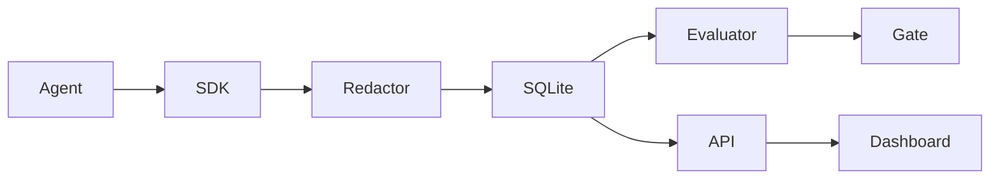

# Architecture

TraceForge keeps its runtime dependency-free. The SDK records nested spans,
the privacy layer redacts data before storage, SQLite persists traces, and the
evaluation package measures the deterministic fixture. The React dashboard is
served by the local API and can also be built as a static GitHub Pages site.

The bundled agent and its metrics are synthetic examples, not production model
quality measurements.
